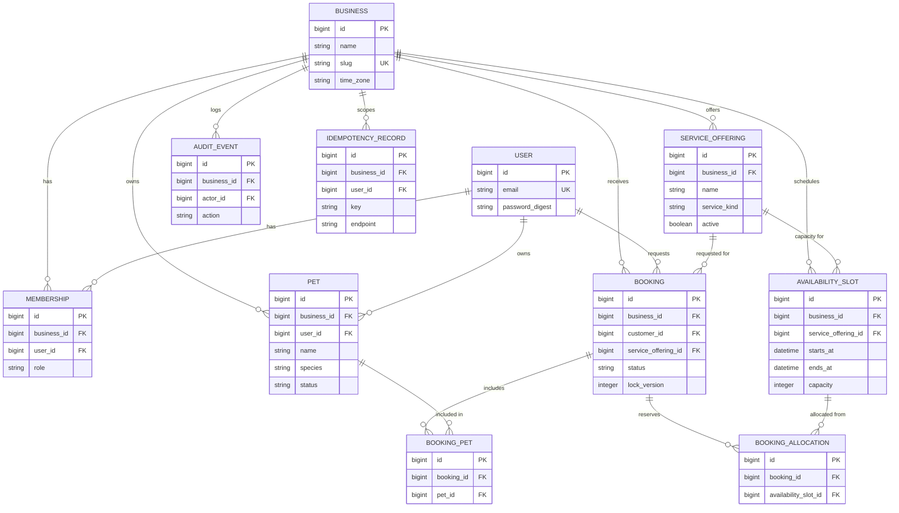

# Architecture

## System overview

PawBookings CRM is a multitenant booking platform for dog daycare,
boarding, and training businesses. A **Business** is the tenant. Staff
users manage services, availability, and bookings; customer users
request bookings for their pets.

The system is a conventional two-process web app:

- `backend/` — Ruby on Rails, API-only, PostgreSQL, Pundit for
  authorization, Solid Queue for background jobs.
- `frontend/` — React (JavaScript) single-page app, Vite, React Router,
  TanStack Query for server state.

There is no microservice split, no message broker, and no separate
read/write database. A single Postgres database backs both the
application data and Solid Queue's job tables (see
[ADR 0003](decisions/0003-slot-allocation-capacity-model.md) and the
Solid Queue note in the README) — the operational simplicity of one
database to run, migrate, and back up outweighs the isolation benefits
of a second one at this project's scale.

## Backend/frontend boundary

The frontend never talks to the database or encodes business rules
about capacity, tenancy, or authorization — it calls versioned JSON
endpoints under `/api/v1` and renders what comes back. All of the
following are backend-only concerns, enforced regardless of what the
UI does or doesn't show:

- Tenant resolution and isolation
- Role-based authorization
- Booking state transitions and capacity checks
- Idempotency handling

This means the API must be usable and safe from something other than
the bundled frontend (e.g. `curl`, a future mobile client) without any
loss of security. See [docs/authorization.md](authorization.md) for
the specific policy layer (added once authorization is implemented).

## Domain model (entity-relationship diagram)

Every tenant-owned table has a non-null `business_id`. This is enforced
even where it's technically redundant with a join (e.g. `Pet` could in
principle derive its business through some other path) — see
[docs/tenancy.md](tenancy.md) for why direct denormalized `business_id`
columns are used everywhere instead of relying on association chains.

## Trade-offs and rejected alternatives

- **No microservices.** One Rails app and one React app is simpler to
  build, test, deploy, and reason about than a service-per-domain
  split, at a scale where a single Postgres instance is nowhere near
  its limits. A microservice split would add network calls,
  distributed transactions, and deployment complexity with no
  corresponding benefit here.
- **No generic repository/data-access layer over Active Record.**
  Active Record already is the repository pattern for a single-database
  Rails app; wrapping it in another abstraction would hide the ORM
  without replacing it, for no real portability gain (see
  [ADR 0004](decisions/0004-application-layer-tenant-isolation.md)).
- **No caching layer yet.** Nothing in this app is read-heavy enough
  to justify the invalidation complexity a cache would add. See
  [docs/performance.md](performance.md) (added once query patterns are
  established) for where caching was deliberately left out.
- **Small service objects, not callback-heavy models.** Booking
  acceptance/denial/cancellation involves multiple steps (locking,
  capacity checks, allocation creation, audit logging) that don't
  belong in `ActiveRecord` callbacks, where ordering is implicit and
  side effects are easy to trigger unintentionally from unrelated code
  paths (e.g. a seed script or console session). A plain Ruby service
  object makes the workflow's steps explicit and independently
  testable.
