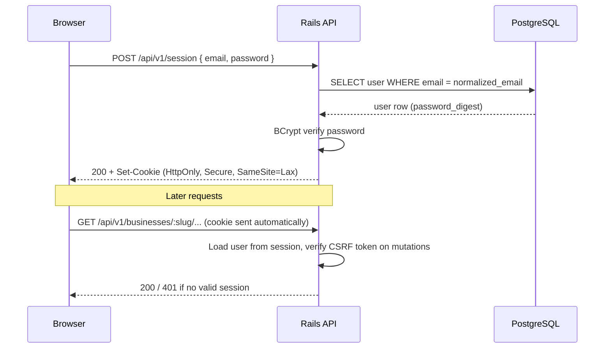
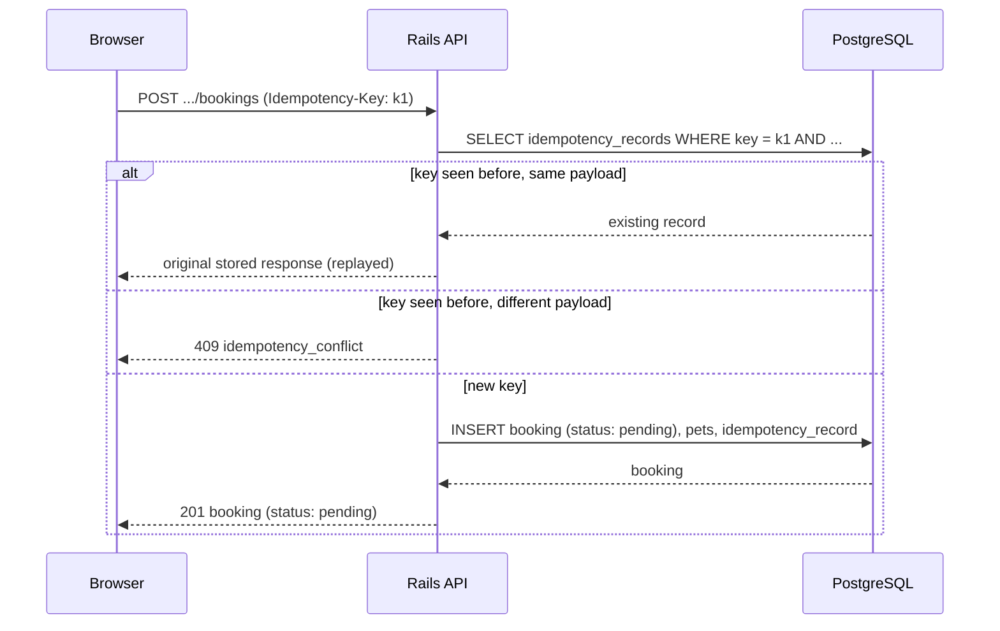
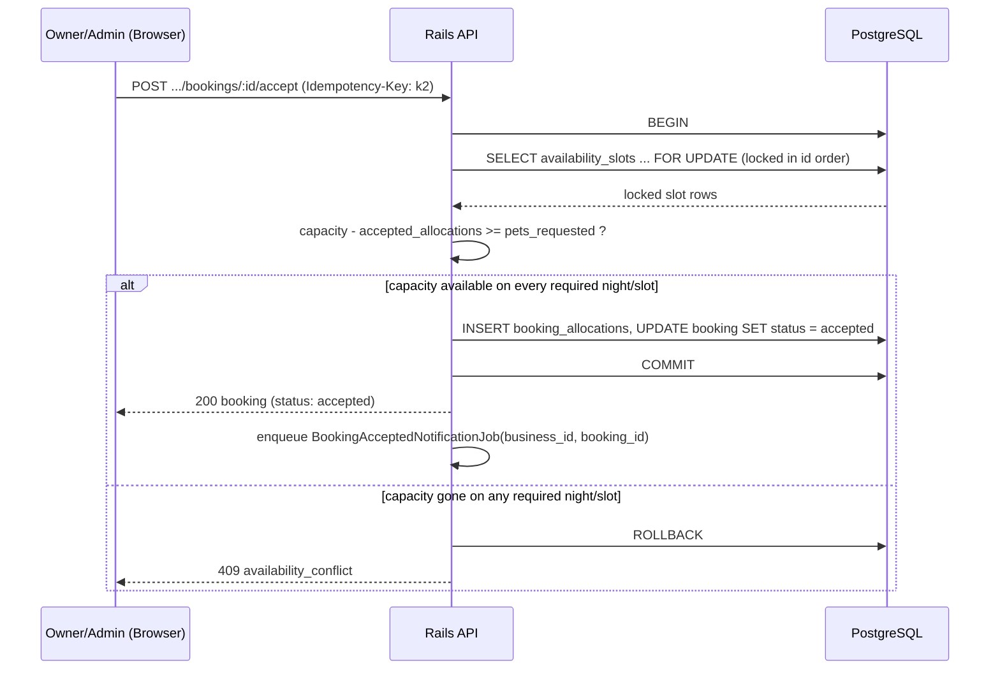

# Data flow

## Authentication flow

Cookie-based sessions, not bearer tokens in local storage (see
[ADR 0002](decisions/0002-cookie-sessions.md)).

The session cookie is opaque to JavaScript (`HttpOnly`): the frontend
never reads or stores a token, so there's nothing for an XSS payload to
exfiltrate from `localStorage`. CSRF protection covers the cookie being
replayed cross-site.

## Booking-request data flow

Pending requests **do not** reserve capacity (see
[ADR 0005](decisions/0005-pending-requests-no-capacity-reservation.md)).
This flow is intentionally simple — no locking is needed here because
nothing is being reserved yet.

See [docs/idempotency.md](idempotency.md) for the full
key/fingerprint/expiry lifecycle.

## Booking-approval data flow

Acceptance is the one place capacity is actually checked and reserved,
so it needs row locking and a transaction (see
[ADR 0003](decisions/0003-slot-allocation-capacity-model.md)).

Locking every affected slot in a consistent order (by primary key)
before checking capacity is what prevents two concurrent accept
requests from both seeing "capacity available" and both succeeding —
see the concurrency test described in [docs/testing.md](testing.md)
that exercises this with two simultaneous requests for the last slot.
