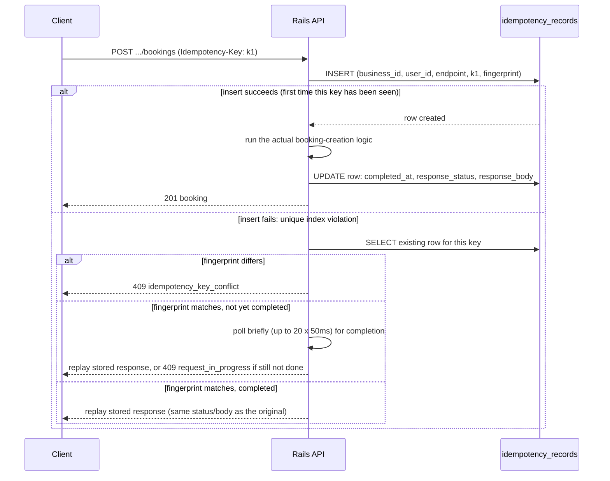

# Idempotency

## Why

Booking-related mutations (create, accept, deny, cancel) can be
retried — a mobile network drops, a browser tab is closed mid-request,
a load balancer times out and the client resends. Without idempotency,
a retried "create booking" could create two bookings for the same
request, or a retried "accept" could double-fire the notification job.
Every mutating endpoint under a business (`bookings#create`, `#accept`,
`#deny`, `#cancel`) requires an `Idempotency-Key` header and is wrapped
in `IdempotentOperation` (`app/services/idempotent_operation.rb`).

## Key scope and fingerprint

A key is scoped to `(business_id, user_id, endpoint, key)` — the same
key string used by two different users, or against two different
endpoints, is a different logical request. This is enforced by a
unique index, not just application logic:

```ruby
add_index :idempotency_records, %i[business_id user_id endpoint key],
          unique: true, name: "index_idempotency_records_scope"
```

The request body is hashed into a `request_fingerprint`
(`SHA256(payload.to_json)`) and stored alongside the key. Reusing a key
with the *same* fingerprint is a retry (replay the original response);
reusing it with a *different* fingerprint is a client bug or an attack
and is rejected outright rather than silently processed or replayed.

## Lifecycle



## Who "wins" a concurrent race

Two requests with the same key arriving at (almost) the same instant
both attempt the `INSERT`. The database's unique index — not a Ruby
mutex, not `SELECT ... FOR UPDATE`, not a distributed lock — guarantees
exactly one of them succeeds. The loser reads back whatever the winner
is doing/did and either replays its response or waits briefly for it to
finish. This is what actually prevents two concurrent "create booking"
requests with the same key from both creating a booking; see the
concurrency spec in `spec/services/idempotent_operation_spec.rb` (three
threads racing the same key, asserting only one `IdempotencyRecord` row
and one distinct response body exist afterward).

## A failed attempt is not cached as a success

If the wrapped block raises, the claim row is destroyed rather than
marked complete:

```ruby
def process(record)
  outcome = yield
rescue StandardError
  record.destroy
  raise
else
  record.update!(completed_at: Time.current, response_status: outcome.status, response_body: outcome.body.to_json)
  outcome
end
```

This means a request that failed for a transient reason (e.g. a
deadlock, a dropped DB connection) can be retried with the *same* key
and will genuinely reprocess, rather than replaying a cached 500
forever. A request that failed because the *booking itself* was
invalid (e.g. a validation error) is cached as that specific 4xx
response, though — see `booking_json`/`validation_failed_outcome` in
`BookingsController`, which build an `Outcome` (not raise) precisely so
`IdempotentOperation` treats a validation failure as a legitimate,
replayable completed response rather than an exception.

## Expiry: garbage collected, not read-path enforced

Every record gets an `expires_at` (24 hours from creation, see
`IdempotentOperation::TTL`). The *read path* — looking up an existing
record for a key — does **not** check `expires_at`. Checking expiry
there correctly would need its own locking (an expired record being
"replaced" mid-request by two concurrent retries is exactly the kind of
race this whole class exists to prevent), which is a lot of added
complexity for what is, in practice, a rare edge case (a client retrying
the exact same logical request more than 24 hours later).

Instead, `CleanUpExpiredIdempotencyRecordsJob` deletes expired records
periodically (hourly, see `config/recurring.yml`). By the time a client
retries long after the TTL, the old record is simply gone, and the
request is naturally treated as brand new — no special-cased expiry
logic needed in the hot path at all. This is the same approach most
idempotency-key implementations use in practice.

## Response shape

Idempotency-related failures use the same error envelope as everything
else (see `app/controllers/concerns/error_handling.rb`):

| Situation | HTTP status | `error.code` |
|---|---|---|
| No `Idempotency-Key` header sent | 400 | `missing_idempotency_key` |
| Same key, different request body | 409 | `idempotency_key_conflict` |
| Same key, still processing (poll window exceeded) | 409 | `request_in_progress` |

## What is *not* idempotent (by design)

`GET`/`index`/`show` endpoints don't take an `Idempotency-Key` — reads
have no side effects to deduplicate. Membership, service, and
availability-slot management endpoints also don't use this mechanism:
they're plain CRUD with ordinary validation, not multi-step workflows
where a retry could cause a duplicate real-world effect (an accidental
double-`PATCH` of a service's name is harmless; an accidental
double-booking is not).
